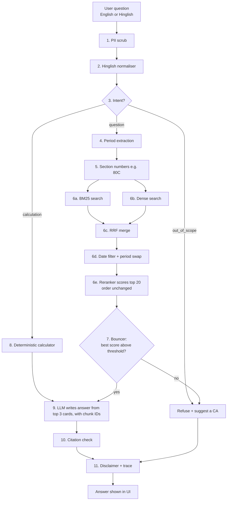

# TaxSaathi for people who have never studied NLP

*If you can follow a cricket scorecard, you can follow this.*

---

## Part 1: The story

Imagine a small **tax help desk** in a library. People walk up and ask questions like *"Bhai, 80C mein kitna deduction milta hai?"* or *"What's the GST on cement now?"*. Here is what happens behind the desk, one helper at a time.

### 1. The privacy clerk (PII scrub)
Before anything is written in the logbook, a clerk blacks out PAN numbers, Aadhaar numbers and phone numbers with a marker. We keep notes on questions, never on people.

### 2. The translator (Hinglish normalisation)
Many people mix Hindi and English: *"salary pe tax kitna lagega"*. Our search tools understand English best, so a translator with a small phrasebook rewrites the helper words: *kitna → how much*, *pe → on*, *lagega → will apply*. Words like "salary", "tax" and "80C" are left alone. The phrasebook is just a list. Nothing clever or mysterious happens here.

### 3. The receptionist (intent classifier)
The receptionist looks at the question and puts it in one of three trays:
- **"question"**: someone wants an explanation from the law,
- **"calculation"**: someone wants a number computed ("my salary is 12 lakh, how much tax?"),
- **"out of scope"**: not our job ("Who will win the IPL?", "Fight my tax notice for me").

The receptionist learned this from 342 example questions with the right tray marked. Think of a new employee who has read 342 past tickets and spotted which words usually go with which tray.

### 4. The calendar keeper (period extraction)
Tax law **changed recently**:
- From **1 April 2026**, a brand-new **Income-tax Act, 2025** applies, and it talks about a "**Tax Year**" instead of "Assessment Year / Previous Year".
- From **22 September 2025**, GST rates changed to mainly **5% and 18%**, with **40%** for a few luxury and "sin" goods.

So the calendar keeper asks: *which time period is this person asking about?* "FY 2024-25" means the old Act. "Tax Year 2026-27" means the new Act. "Before GST 2.0" means the old GST rates. If the person doesn't say, we assume **today's law** and **say so out loud** in the answer.

### 5. The librarian with two search methods (hybrid retrieval)
Our library has **107 small cards** (**chunks**) written from **17 official sources**, each holding one rule from the law, its section number, and its source. 72 of them were checked word-by-word against an official government page; the other 35 also lean on reputable secondary sources and are marked "partial".

The librarian searches **two ways at once**:
- **Method A, the index at the back of the book (BM25).** Finds cards that contain the *exact words* you used. Great for "80C", "Form 16", "44ADA".
- **Method B, the "I know what you mean" search (dense embeddings).** Finds cards that *mean* the same thing even with different words. "Tax kam kaise karein" finds the deductions card even though it never says "kam".

Each method produces a ranked list. The librarian then **merges the two lists fairly (RRF)**: a card ranked high by *both* methods rises to the top, and a card only one method liked still gets a chance.

### 6. Sticky notes with dates (metadata + date filter + period substitution)
Every card has a **sticky note**: "valid from ___ to ___". After the search, the librarian removes any card whose dates don't match the period from step 4. An old GST rate card can't sneak into an answer about today.

But throwing a card away is not enough: the right rule might then be missing altogether. So the librarian also does a **swap (period substitution)**:
- *If the librarian hands you last year's rule book page, swap it for this year's page of the same rule.* Example: you ask about GST on an AC in August 2025, and the search found the "from 22 September 2025" AC card. That card is removed and the "before 22 September 2025" AC card takes its place. Same rule, right year.
- *If you ask about a year before our books start, you get the oldest page we have, with a note.* We don't have cards for, say, 2019. Instead of answering with nothing, we keep the closest (oldest) version and the trace says so ("kept closest").

How does it know two cards are "the same rule"? Their IDs share a stem (e.g. `GST-RATE-AC-PRE` and `GST-RATE-AC-POST`) or they have the same topic.

### 7. The careful second reader (reranker), now only a confidence check
The librarian hands over the **top 20 cards**. A slower, more careful reader reads **your question and each card side by side** and gives each card a score for "does this really answer it?".

At first we let this reader **re-order** the cards. That made things **worse**: our reader only really knows English and Chinese, and it often pushed a *related* card or the *wrong year's* card to the top. (The scores dropped: the ranking score MRR fell from 0.755 to 0.656.)

So in the final system (**C6**) the careful reader **no longer changes the order**. The librarian's order stays. The careful reader now only answers one question: ***"Am I sure enough to answer?"*** Its best score goes to the bouncer (step 8). This change gave our best results of all: Recall@5 **0.917**, MRR **0.830**.

Why not let the careful reader read all the cards? Because careful reading is slow. Fast search narrows things down to 20, and the careful reader only scores those.

### 8. The bouncer (guardrail gate)
At the door stands a bouncer with two rules:
1. If the receptionist said "out of scope", the bouncer stops it.
2. If even the best card got a low score from the careful reader (meaning we don't really have an answer), the bouncer stops it.

When stopped, TaxSaathi says politely: *"I'm not confident about this one. Please consult a Chartered Accountant."* **Saying "I don't know" is a feature, not a failure.**

### 9. Calculator vs. a person doing mental maths (deterministic calculator)
If the question is a "calculation", we **do not** ask the language model to do the maths. Language models are like a confident friend doing mental maths: usually close, sometimes badly wrong, and never unsure. We use a real **calculator program** written by hand and checked by **99 automatic tests** (including hand-worked examples). It computes tax under the old and new regimes and says which is cheaper. If your salary is missing, it asks you instead of guessing.

It understands the way real people write:
- **Freelancers.** "I'm a freelance designer earning ₹40 lakh" uses the *presumptive* rule: section 58 of the new Act (the old section 44ADA). Only **50% of your receipts counts as income**, so ₹40 lakh of receipts is taxed as ₹20 lakh of income.
- **Foreign currency.** "I earn $5k a month remote" is converted to rupees at the **RBI reference rate** (the official daily exchange rate), and the answer shows the rate it used.
- **"Per month".** "1 lakh per month" is multiplied by 12. If you don't say, it assumes the amount is yearly *and tells you so*.

**One firm rule:** in a calculation answer, **every number and every verdict ("the new regime is cheaper", "no tax") comes from the calculator only**. The answer starts with the calculator's own explanation. The AI writer may add a sentence or two of *why* (with a card ID), but any sentence of its own that contains a number or a verdict is thrown away. (We added this after the small AI once wrote "you would not have to pay any tax" right next to a ₹4.5 lakh tax bill.)

### 10. The writer (grounded generation by the LLM)
Now a small AI writer (**Qwen 2.5, 3B**, running on our own server through **Ollama**) gets the **top 3 cards** and one instruction: *"Explain the answer using only these cards. After every sentence, write the card's ID in brackets. Do not do any maths."*

### 11. The fact-checker (citation check)
The fact-checker reads every sentence the writer produced:
- No card ID after it? **Deleted.**
- A card ID that wasn't among the 3 cards it was shown? **Deleted.**
- In a calculation answer, any sentence from the AI with its own number or verdict? **Deleted** (the calculator speaks for the numbers).
- If too little is left, we show the best card's text directly instead.

### 12. The fine print (disclaimer)
Every answer ends with: *this is general information, not professional advice*.

And the whole journey through steps 1–12 is saved as a **trace**, so in the demo you can click and see exactly what each helper did.

---

## Part 1b: The scorecard (final system, C6)

We built the system one piece at a time (B0 → B1 → C1 … → C6) and measured after every piece, on 53 practice ("dev") questions. The final version is **C6**.

| What we measured | Plain AI (B0) | TaxSaathi (C6) | Target |
|---|---|---|---|
| Right card in the top 5 (Recall@5) | — | **0.917** | ≥ 0.85 ✅ |
| Answers containing all the key facts | **10%** | **69%** | — |
| Sentences backed by a valid card (faithfulness) | — | **1.00** | ≥ 0.90 ✅ |
| Out-of-scope questions refused | 0% | **100%** (2.1% wrongly refused) | ≥ 90% ✅ |
| Calculator exact | — | **100%** (16/16 worked examples, 99 tests) | 100% ✅ |
| Typical wait (median) | 1.4 s | **16.8 s** | ≤ 5 s ❌ |

**4 of 5 targets met.** The one we miss is speed: a 3B AI on an ordinary CPU server (no graphics card) takes about 17 seconds to write. With a GPU or a hosted AI it would be a few seconds.

The 70% "final exam" questions (123) are still sealed; we open them once, for M4.

---

## Part 1c: What 80 real questions taught us

Our own 176 test questions were written by us. To see how real people ask, we collected **80 real questions** from **Reddit (36), official FAQ pages (25), CAclubindia and one YouTube comment (12) and Quora (7)**. We only used public pages, removed every name and username, and kept a link to each source. We **never tuned anything** on these questions; they are a one-off reality check.

What we found:
- **Our library fully answers 64%** of them, partly 23%, not at all 14%. Most misses are long forum posts mixing three problems, or GST "changeover" questions (old stock, credit notes).
- **The most common confusion (10 posts):** *"No tax up to ₹12 lakh, but the slab table says 5% from ₹4 lakh. Which is it?"* Both are true (the rebate cancels the slab tax up to ₹12 lakh). We had no card that said this plainly, so we **wrote an explainer card**. That is how we got to 107 cards.
- **People write money the way they think:** "$5k a month remote", "1.2 L per month", "freelance ₹40 lakh". That is why the calculator learned **foreign currency, per-month amounts and freelancers** (step 9).
- **Finding the right rule: 78%** of the fully covered real questions, against 92% on our own questions. Real wording is messier. Also, many 2025 posts were labelled with *last year's* card, while TaxSaathi deliberately answers with *today's* law (counting "the same rule, any year" gives the 78%).
- **Refusing is harder in real life:** only **4 of 7 (57%)** real out-of-scope questions (NRI, crypto, US stocks…) were refused, against 100% on our own. People wrap them in normal-sounding tax words. Fixing this is next.
- **Real Hinglish is rare in writing:** we found only 1 genuine Hinglish question. People write to forums in English; Hinglish lives in speech and YouTube.

---

## Part 2: Diagrams

### Offline flow (done once, before anyone asks anything)

```
  Official sources              Team writes curated            ingest.py
  (Act 2025, Act 1961,   --->   summary files, one     --->   splits into chunks,
   GST notifications,           "##" block per idea,          reads the sticky notes
   PIB / CBIC pages)            with section + dates          (metadata)
                                                                   |
                         +-----------------------------------------+
                         v                                         v
                 BM25 word index                          Dense vector index
             (which words are on which card)       (each card -> 384 numbers, via E5)
                         |                                         |
                         +---------------> chunks.jsonl <----------+

  Separately:  gold.jsonl (test questions + right answers)  -> split 30% dev / 70% test
               intent_train.jsonl (342 examples, NOT copied from gold) -> train receptionist
```

### Online flow (every question)



---

## Part 3: One Hinglish question, step by step

**Question:** *"Bhai 80C mein kitna deduction milta hai FY 2025-26 ke liye? Mera PAN ABCDE1234F hai"*

> The scores and IDs below are **illustrative**, made up to show the mechanics. They are not experiment results.

| Step | What happens | Output (illustrative) |
|---|---|---|
| 1 PII scrub | PAN pattern found | "...Mera PAN [PAN] hai" (logs never see the real PAN) |
| 2 Hinglish | Language detected: Hinglish. Replacements: *mein→in, kitna→how much, milta hai→is available, ke liye→for* | "bhai 80C in how much deduction is available FY 2025-26 for? ..." |
| 3 Intent | TF-IDF + LogReg probabilities | question 0.91, calculation 0.07, out_of_scope 0.02 → **question** |
| 4 Period | "FY 2025-26" found | start 2025-04-01, end 2026-03-31, `assumed_current = false` → **Income-tax Act, 1961 applies** (the year ends before 1 Apr 2026) |
| 5 Entities | "80C" found | mapping lookup boosts the 80C chunk and the old→new mapping chunk (secondary sources map 80C to s.123 of the 2025 Act) |
| 6a BM25 | exact match on "80C", "deduction" | IT61-80C-LIMIT, MAP-80C-123, IT25-123-DEDUCTION, ... |
| 6b Dense | meaning match | IT25-123-DEDUCTION, IT61-80C-LIMIT, IT61-80D-HEALTH, ... |
| 6c RRF | merge ranks with 1/(60+rank) | IT61-80C-LIMIT first (ranked high by both) |
| 6d Date filter | drop cards not valid in FY 2025-26; swap in the in-period version of the same rule if there is one | IT25-123-DEDUCTION (valid from 2026-04-01) **removed**; its FY 2025-26 twin is already in the list, so nothing to swap; 20 → 14 cards |
| 6e Rerank | careful reader scores the 14 cards; **order is not changed** | best score is high (IT61-80C-LIMIT) |
| 7 Bouncer | best score above threshold, intent ok | **pass** |
| 9 LLM | gets the top 3 cards; writes 2–3 sentences, each with `[IT61-80C-LIMIT]` etc. | "For FY 2025-26, Section 80C of the Income-tax Act, 1961 allows a deduction of up to ₹1,50,000 under the old regime [IT61-80C-LIMIT]. From Tax Year 2026-27 the same benefit sits in Section 123 of the Income-tax Act, 2025 [MAP-80C-123]." |
| 10 Citation check | every sentence cited, all IDs among the 3 cards shown | kept 2, dropped 0 |
| 11 Disclaimer | appended | "General information only, not professional advice." |

*Why the ₹1,50,000 figure is fine here:* it comes from the cited card, not from the LLM's memory. If the card were wrong, the citation shows exactly which card to fix.

---

## Part 4: Glossary (every term in the project)

| Term | Plain meaning | Why we need it |
|---|---|---|
| **NLP** | Natural Language Processing: getting computers to work with human language. | It's the subject of the course and the project. |
| **LLM** | Large Language Model: an AI that predicts the next word and can write fluent text (e.g. Qwen, ChatGPT). | Turns cards into a readable answer. |
| **RAG** | Retrieval-Augmented Generation: search first, then let the LLM write *using what was found*. | Keeps the LLM tied to real, current law instead of its memory. |
| **Token** | A piece of a word that a model reads (e.g. "deduction" may become "deduc" + "tion"). | Models measure input length and cost in tokens. Our chunks are 60–220 words. |
| **Chunk** | One small card of knowledge: one rule, one section, with its dates and source. | Small cards make search precise and citations exact. |
| **Metadata** | Facts *about* a chunk: section, law, valid-from/to dates, source URL. | The "sticky notes" that drive the date filter and citations. |
| **Embedding** | A list of numbers (here 384) that captures a text's meaning. Similar meanings get similar lists. | Lets us search by meaning, not just exact words. |
| **Vector** | Just a list of numbers. An embedding is a vector. | It's how meaning is stored and compared. |
| **Cosine similarity** | A score from −1 to 1 for how much two vectors "point the same way". Close to 1 means similar meaning. | How dense search decides which cards are closest to the question. |
| **TF-IDF** | Term Frequency × Inverse Document Frequency: a word counts more if it's frequent in this text but rare overall. | Turns questions into numbers for the intent classifier. |
| **BM25** | An improved TF-IDF-style search score that also handles text length and repeated words sensibly. | Our "exact word" search; excellent for "80C", "Form 16". |
| **Dense retrieval** | Search using embeddings (meaning) instead of exact words. | Finds the right card even when the wording differs. |
| **Hybrid retrieval** | Using BM25 and dense search together. | Each catches what the other misses. |
| **RRF** | Reciprocal Rank Fusion: merge ranked lists by adding up 1/(60 + rank) for each card. | Combines our two searches fairly without comparing their incompatible scores. |
| **Cross-encoder** | A model that reads the question *and* a card *together* and scores how well they match. | More accurate than comparing separate embeddings. |
| **Reranker** | A cross-encoder that scores a shortlist (our top 20). Usually used to re-order it. | We tried re-ordering and it hurt (C3); in the final system (C6) we only use its best score as a confidence check for refusing. |
| **Period substitution** | When the date filter removes a card from the wrong period, the same rule's card for the right period takes its place; for years before our sources start, the oldest version is kept with a note. | The right rule never silently disappears just because the search found the wrong year's page. |
| **Presumptive taxation (s.58 / old 44ADA)** | A simple rule for freelancers and professionals: 50% of receipts is treated as income, no expense bills needed. | The calculator uses it for "I'm a freelancer earning ₹X". |
| **RBI reference rate** | The official daily rupee exchange rate (published by FBIL, shown on the RBI website). | How "$5k a month" becomes rupees in the calculator. |
| **Coverage** | Whether our 107 cards actually contain the answer to a question (full / partial / none). | Tells us whether a miss is a search problem or a missing card. |
| **Real-question set** | 80 questions real people asked online, with links, used only to check the final system. | Our own questions can't show how messy real wording is. |
| **Intent classifier** | A model that labels the question type: question / calculation / out of scope. | Sends each question down the right path. |
| **Logistic regression** | A simple, classic model that weighs features (words) and outputs a probability for each class. | Fast, explainable, works with our 342 training examples, runs on CPU in milliseconds. |
| **Hallucination** | When an AI states something false with confidence. | The main danger in tax answers; everything else is designed to prevent it. |
| **Grounding** | Making every claim come from a provided source (our cards). | No source, no claim. |
| **Citation check** | Our automatic check that each sentence has a valid card ID. | Catches the LLM inventing or misattributing sources. |
| **Guardrail** | Any safety rule around the AI (PII scrub, bouncer, citation check, disclaimer). | Keeps the system safe even when the LLM misbehaves. |
| **Refusal / CA escalation** | Politely declining and recommending a Chartered Accountant. | Better than a confident wrong answer. |
| **Threshold** | A cut-off score; below it, the bouncer refuses. | Chosen on the dev set to balance "refuse too much" against "answer when unsure". |
| **Period extraction** | Finding the time period in a question (FY, AY, Tax Year, "last year"). | Decides which law applies. |
| **Metadata filter / date filter** | Removing cards whose valid-dates don't match the question's period. | Stops old law answering new questions (and the reverse). |
| **Hinglish normalisation** | Rewriting Hindi helper words in Roman script into English. | Our search and reranker understand English best. |
| **Entity recognition** | Spotting specific items like section numbers ("80C") or amounts ("12 lakh"). | Boosts the exact section and feeds the calculator. |
| **Gold set** | Our answer key: questions with the correct cards and key facts. | You can't measure quality without an answer key. |
| **Key facts** | Must-have bits of a correct answer (e.g. "1,50,000", "Form 16"). | A simple, automatic correctness check. |
| **Dev/test split** | Dividing the gold set: dev (30%) for tuning, test (70%) for the final exam. | So we don't fool ourselves. |
| **Data leakage** | When test answers sneak into training or tuning, making scores look better than reality. | We forbid copying gold questions into intent training and tune only on dev. |
| **Recall@5** | Out of the questions, how often the correct card is in our top 5. | Our main search metric; target ≥ 0.85. |
| **MRR** | Mean Reciprocal Rank: average of 1/(position of first correct card). 1st = 1, 2nd = 0.5, 3rd = 0.33. | Rewards putting the right card at the very top. |
| **nDCG** | Normalised Discounted Cumulative Gain: a ranking score where correct cards lower down count less; 1.0 = perfect order. | Judges the whole top-5 order, not just one hit. |
| **Faithfulness** | Share of answer sentences actually supported by the cited cards. | Measures "did it stick to the sources"; target ≥ 0.90. |
| **Latency** | Time from question to answer. | Users won't wait forever; we report real CPU numbers. |
| **Baseline (B0, B1)** | The simple systems we compare against (LLM alone; BM25 only). | Shows our additions actually help. |
| **Ablation** | Adding or removing one component at a time (B0→C6) to see its effect. | Tells us *which* part made the difference. |
| **MLflow** | A tool that records each experiment's settings and scores. | A lab notebook that can't be "forgotten". |
| **FastAPI** | A Python library for building the web API (`/ask`, `/calculate`, ...). | Lets the web demo talk to our pipeline. |
| **Ollama** | A program that runs LLMs locally on our own server. | Free, private, no internet API needed. |
| **Qwen** | A family of open LLMs from Alibaba; we use the small 3B version (`qwen2.5:3b`). | Small enough to run on a CPU server. |
| **Parameters (1.5B, 3B)** | The number of learned numbers inside a model (billions). | Bigger is usually smarter but slower; we picked what fits on CPU. |
| **Quantisation** | Storing a model's numbers with fewer bits (e.g. 4-bit instead of 16-bit) so it uses less memory and runs faster, at a small cost in quality. | How a 3B model fits in 8 GB of RAM. |
| **E5 (multilingual-e5-small)** | The embedding model we use; supports about 100 languages. | Gives us meaning search that tolerates Hindi words. |
| **PII** | Personally Identifiable Information (PAN, Aadhaar, phone). | Must never be stored in logs. |
| **Trace** | A step-by-step record of what the pipeline did for one question. | Transparency in the demo, and debugging. |
| **Deterministic** | Same input → always the same output, no randomness. | Tax maths must be exactly repeatable. |
