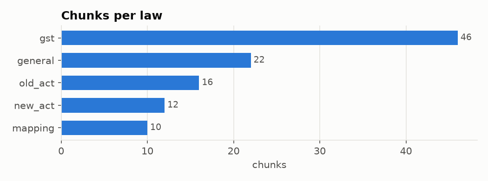
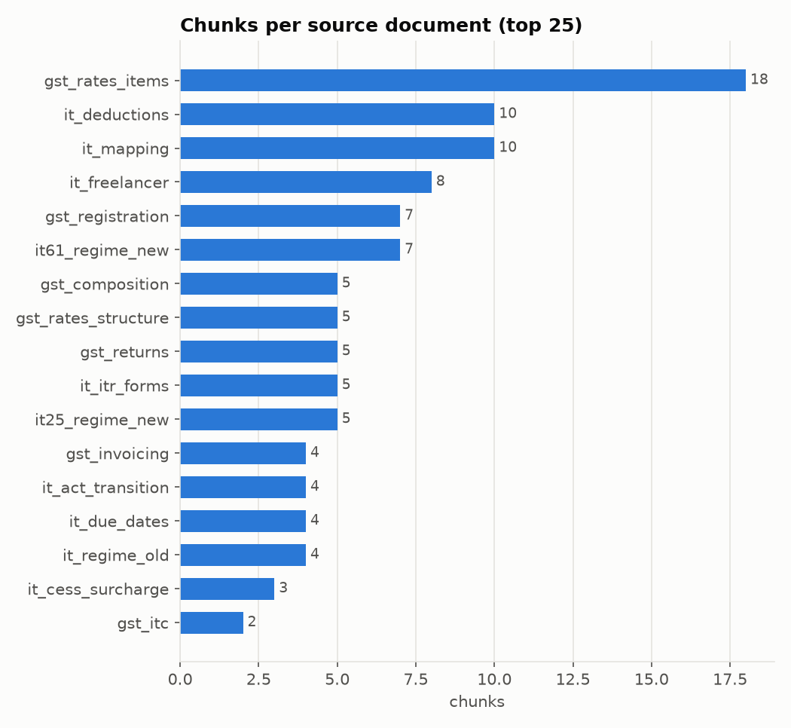
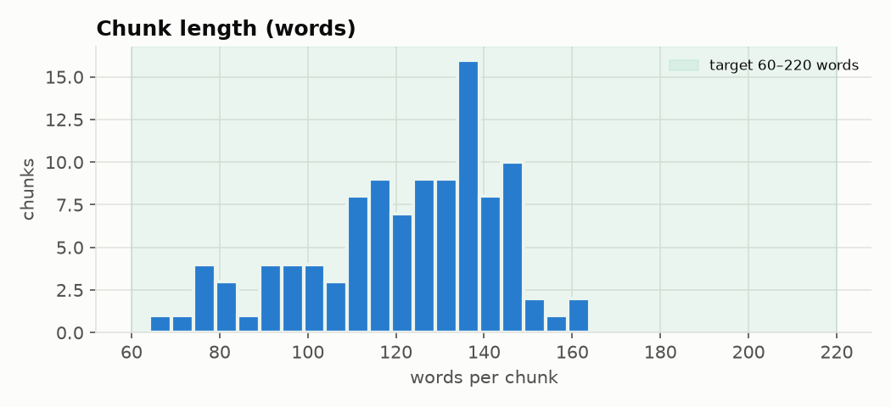
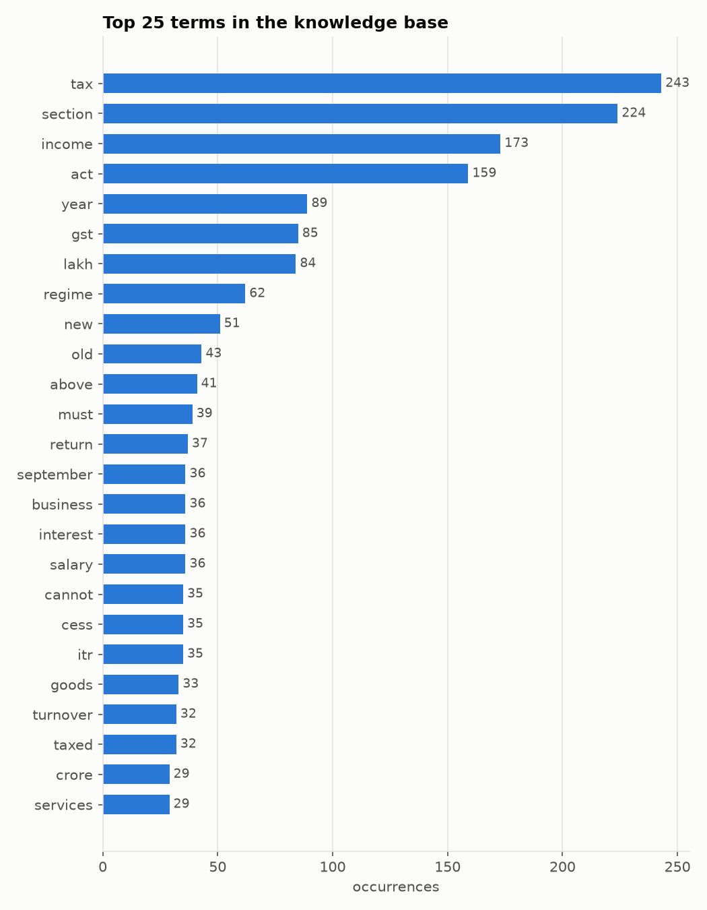
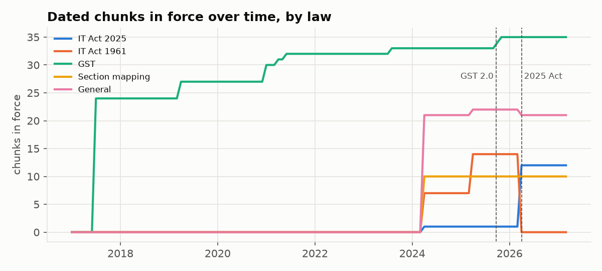
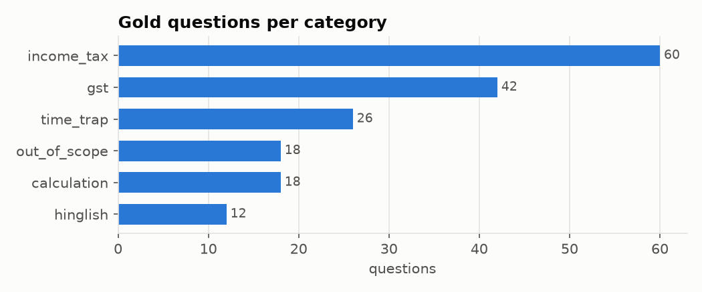

# EDA — knowledge base and gold set

Generated by `python -m scripts.eda` (today = 2026-10-29).

## Knowledge base

- Chunks: **106** from **17** source documents
- Words per chunk: min 64, median 125, mean 121, max 164
- Chunks with effective dates: 106 (100%)
- Verified: yes = 71, partial = 35

| law | chunks |
|---|---|
| gst | 46 |
| general | 22 |
| old_act | 16 |
| new_act | 12 |
| mapping | 10 |

| topic | chunks |
|---|---|
| mapping | 10 |
| deductions | 8 |
| itr_forms | 5 |
| slabs | 5 |
| rates_sin_goods | 4 |
| registration | 4 |
| transition | 4 |
| due_dates | 4 |
| rebate | 4 |
| composition | 3 |
| presumptive | 3 |
| tds | 3 |
| invoicing | 2 |
| rates_consumer_durables | 2 |
| rates_vehicles | 2 |
| rates_construction | 2 |
| rates_fmcg | 2 |
| rates_food | 2 |
| rates_insurance | 2 |
| rates_apparel | 2 |
| rates_services | 2 |
| rate_structure | 2 |
| registration_process | 2 |
| returns | 2 |
| surcharge | 2 |
| hra | 2 |
| advance_tax | 2 |
| standard_deduction | 2 |
| new_regime_deductions | 2 |
| regime_choice | 2 |
| composition_services | 1 |
| composition_returns | 1 |
| invoicing_hsn | 1 |
| invoicing_einvoice | 1 |
| itc | 1 |
| itc_blocked | 1 |
| compensation_cess | 1 |
| registration_freelancer | 1 |
| returns_qrmp | 1 |
| returns_annual | 1 |
| returns_late_fee | 1 |
| cess | 1 |
| old_regime_deductions | 1 |

Most-covered sections: 9 (22), 139 (4), Finance Act s.3 (3), 115BAC (3), 22 (2), 87A (2), First Schedule (2), 10 (1), 10, Rule 7 (1), 10(4), 31(3)(c) (1), 10(2A) (1), Rule 62 (1), 31, Rule 46 (1), 31(3)(c), Rule 49 (1), Rule 46 proviso (1)

## Gold set

- Questions: **176** (answerable 158, not answerable 18)
- Language: en = 164, hinglish = 12
- Difficulty: medium = 82, easy = 73, hard = 21

| category | questions |
|---|---|
| income_tax | 60 |
| gst | 42 |
| time_trap | 26 |
| out_of_scope | 18 |
| calculation | 18 |
| hinglish | 12 |

- gold_chunk_ids not found in the KB: 0

